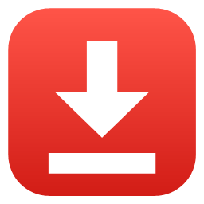
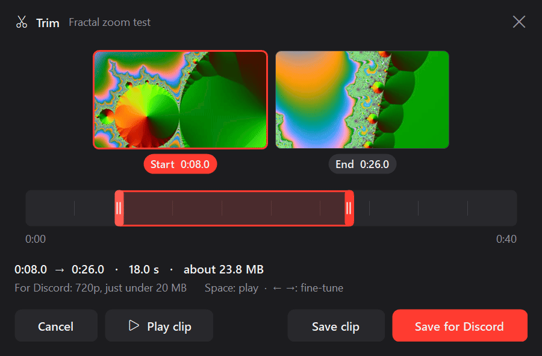
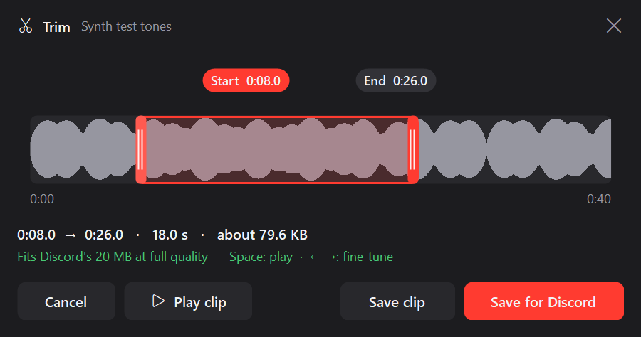
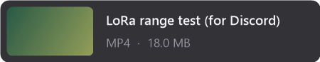
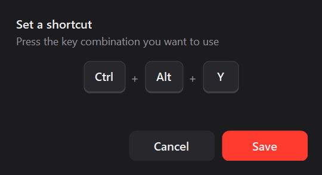

<p align="center">
  
</p>

<h1 align="center">RedDrop</h1>

<p align="center">
  
</p>

<p align="center"><b>Paste a link → get the video → drag it anywhere.</b></p>

<p align="center">
  <a href="https://github.com/DovisLe/RedDrop/releases/latest"></a>
  
  
</p>

<p align="center">
  
</p>

<table align="center">
  <tr>
    <td>⌨️ <b>One shortcut</b>, from any app</td>
    <td>🖱️ <b>Drag &amp; drop</b> into chats, editors, folders</td>
  </tr>
  <tr>
    <td>✂️ <b>Trim</b> with live frames and sound</td>
    <td>🗜️ <b>Shrink</b> to fit Discord's upload limit</td>
  </tr>
  <tr>
    <td>🎬 <b>MP4 or MP3</b>, plays everywhere</td>
    <td>🪶 <b>No CPU</b> while hidden</td>
  </tr>
</table>

<h2 align="center">✂️ Trim it</h2>

<p align="center">
  
</p>

<h2 align="center">🎵 MP3 too</h2>

<p align="center">
  
</p>

<table align="center">
  <tr>
    <th>🖱️ Drag it out</th>
    <th>⌨️ Pick your own shortcut</th>
  </tr>
  <tr>
    <td align="center"></td>
    <td align="center"></td>
  </tr>
</table>

## 🚀 Get started

1. Download **RedDrop.zip** from [the latest release](https://github.com/DovisLe/RedDrop/releases/latest), extract it, run **Install RedDrop.bat**.
2. Press <kbd>Ctrl</kbd> + <kbd>Alt</kbd> + <kbd>Y</kbd>, paste a link, press <kbd>Enter</kbd>.

<sub>The installer gets <a href="https://github.com/yt-dlp/yt-dlp">yt-dlp</a> and <a href="https://ffmpeg.org">FFmpeg</a> from their official winget packages, plus .NET 10 if needed. "Windows protected your PC"? The app isn't code-signed: click <b>More info → Run anyway</b>.</sub>

## 🔒 Privacy · ⚖️ Legal

- No accounts, ads or tracking. The weekly update check is off unless you turn it on, and it only asks GitHub for the newest version number.
- Only download videos you own, that are openly licensed, or that you have permission to save. RedDrop isn't affiliated with YouTube, Google, Discord or any video site.

<details>
<summary><b>More detail</b></summary>

**Privacy.** The only network use is yt-dlp downloading the links you paste, plus the optional update check. The installer asks whether to turn it on. Updates install only when you click, and only if the file matches the release's SHA-256 checksum. Settings and a small log stay in the app's folder.

**Legal.** RedDrop runs yt-dlp and FFmpeg, which you install separately; it doesn't download or convert anything itself. Many sites, YouTube included, only allow downloading where they offer it. You're responsible for what you download and share. yt-dlp (Unlicense) and FFmpeg (LGPL/GPL) are separate programs and aren't included here.

**Build from source.** You need the [.NET 10 SDK](https://dotnet.microsoft.com/download/dotnet/10.0).

```bash
powershell -ExecutionPolicy Bypass -File build.ps1     # builds app\RedDrop.exe
powershell -ExecutionPolicy Bypass -File package.ps1   # builds release\ (zip, exe and .sha256)
```

</details>

---

<sub>Made for myself, mostly with AI help (Claude Code), and tested on my own Windows 11 PC. It's a hobby project: expect rough edges, and issues and pull requests are welcome. <a href="LICENSE">MIT licence</a>, no warranty.</sub>
