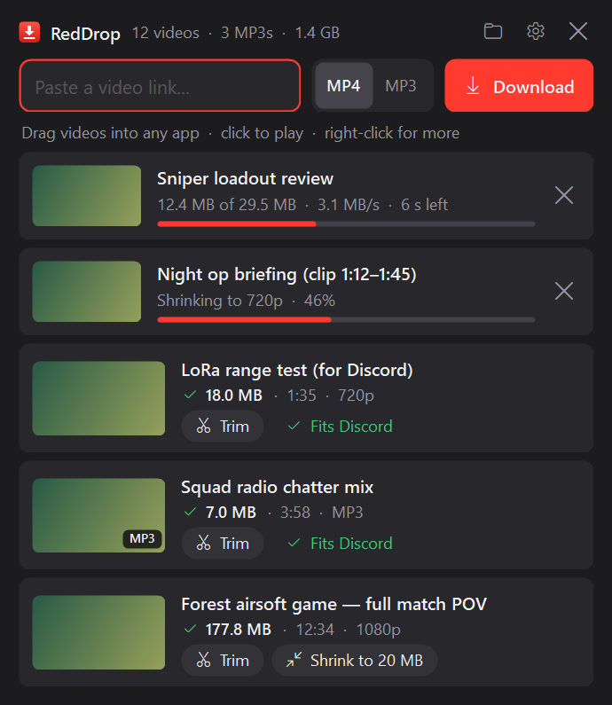

# RedDrop

A small Windows tray app: press **Ctrl+Alt+Y**, paste a video link, press Enter. When it's done, drag the MP4 or MP3 straight into a chat, an editor or a folder, the same way you'd drag a file from a browser's download bar.



## Features

- **Hotkey panel**: opens on top of whatever you're doing. Choose MP4 (H.264 + AAC, plays everywhere) or MP3 (audio only).
- **Drag out**: finished files can be dragged into any app. The card shows each file's size.
- **Trim**: drag the start and end handles while it shows the frames (or the waveform for MP3), then play the clip with sound.
- **Shrink**: saves a smaller copy that fits Discord's 20 / 50 / 500 MB upload limit (free / Nitro Basic / Nitro). Your original is never replaced.
- **Light**: uses no CPU while hidden and gives its memory back to Windows.


## Install

1. Download `RedDrop.zip` from [Releases](../../releases), extract it and run **Install RedDrop.bat**.
2. The installer gets [yt-dlp](https://github.com/yt-dlp/yt-dlp) and [FFmpeg](https://ffmpeg.org) from their official winget packages, plus the .NET 10 Desktop Runtime if you don't have it.
3. Windows may say "Windows protected your PC" because the app isn't code-signed. Click **More info → Run anyway**, or build it yourself (see below).

Needs Windows 10 or 11 (x64). To uninstall, run **Uninstall RedDrop.bat**. Your downloads are kept.

## Privacy

- No accounts, ads, analytics or telemetry.
- The only network use is yt-dlp downloading the links you paste, plus an optional update check.
- The update check is off unless you turn it on (the installer asks). It asks GitHub for the newest version number at most once a week. An update is installed only when you click it, and only if the file matches the SHA-256 checksum published with the release.
- Settings and a small log stay in the app's folder on your PC.

## Use it legally

RedDrop doesn't download or convert anything itself: it runs yt-dlp and FFmpeg, which you install separately. Only download videos you own, that are openly licensed (for example Creative Commons or public domain), or that you have permission to save. Many sites, YouTube included, only allow downloading where they offer it. You're responsible for what you download and share.

RedDrop isn't affiliated with or endorsed by YouTube, Google, Discord or any video site.

## Build from source

You need the [.NET 10 SDK](https://dotnet.microsoft.com/download/dotnet/10.0).

```bash
powershell -ExecutionPolicy Bypass -File build.ps1     # builds app\RedDrop.exe
powershell -ExecutionPolicy Bypass -File package.ps1   # builds release\ (zip, exe and .sha256 for a GitHub release)
```

## Honest note

I made this for myself, mostly with AI help (Claude Code), and tested it on my own Windows 11 PC. It works well for me, but it's a hobby project: expect rough edges. Issues and pull requests are welcome.

## Licence

[MIT](LICENSE), with no warranty. yt-dlp (Unlicense) and FFmpeg (LGPL/GPL) are separate programs. They aren't included in this repository or in the release zip.
